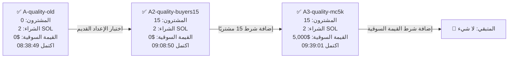

# اختبار جودة الدخول — مكتمل 100%

## ماذا اختبرنا؟

- ✅ **A-quality-old:** الأداء بالشروط القديمة دون حد أدنى للمشترين أو القيمة السوقية.
- ✅ **A2-quality-buyers15:** تأثير اشتراط 15 مشتريًا حقيقيًا.
- ✅ **A3-quality-mc5k:** تأثير إضافة حد أدنى للقيمة السوقية قدره $5,000.

## الاختبارات المحذوفة

- ❌ `B-quality-25` — حُذف نهائيًا.
- ❌ `C-quality-30` — حُذف نهائيًا.

كانا قد نُفّذا مرة قبل الحذف، لكنهما لم يعودا جزءًا من الجدول ولن يعملا مستقبلًا.

**النتيجة:** 3 من 3 مكتملة — لا توجد اختبارات جودة متبقية.
